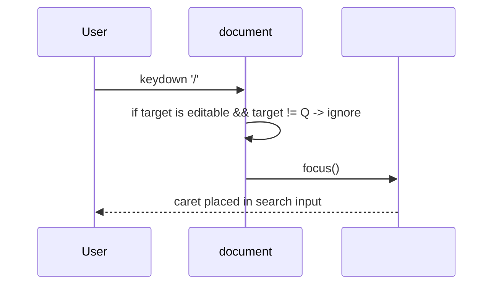

# Design

## Context

В UI (practices/practice_05/public/index.html) есть поле ввода `#query`, управляемое состоянием `state` и функциями `validateQueryInline`, `resetFilters`, `fetchItems`. Нужно добавить глобальный хоткей `/`, который переводит фокус в `#query` без вмешательства в сервер и существующие механизмы.

## Goals / Non-Goals

**Goals:**
- При нажатии `/` (слэш) фокусировать `#query`, если пользователь не вводит текст в другом контроле.
- Сохранять текущее значение `#query` неизменным (не очищать).
- Не блокировать ввод `/` в текстовых полях и редакторах, если фокус уже внутри них.

**Non-Goals:**
- Любые изменения server.js или API.
- Добавление внешних библиотек.

## Decisions

- Добавить обработчик `keydown` на `document`.
- Игнорировать событие, если `event.target` — редактируемый элемент (input, textarea, contentEditable) и это не `#query`.
- Реагировать только на `key === '/'` или `key === 'Slash'` без модификаторов; при срабатывании вызывать `$('#query').focus()` и `event.preventDefault()`.
- Никаких побочных эффектов (не вызывать `resetFilters`, не менять `state.query`).

## Risks / Trade-offs

- Различия раскладок клавиатуры: на некоторых раскладках `/` требует модификатор → будем проверять `key` и символ ввода, избегая глобального перехвата при модификаторах.
- Конфликт с другими хоткеями: ограничим обработку до случая без Ctrl/Alt/Meta.

## Migration Plan

- Изменение ограничено index.html: добавить один обработчик `keydown` на документ.
- Проверка: при нажатии `/` в не-редактируемом контексте фокус переходит в `#query`; при наборе текста в любом input/textarea поведение не меняется.

## Open Questions

- Нет.
